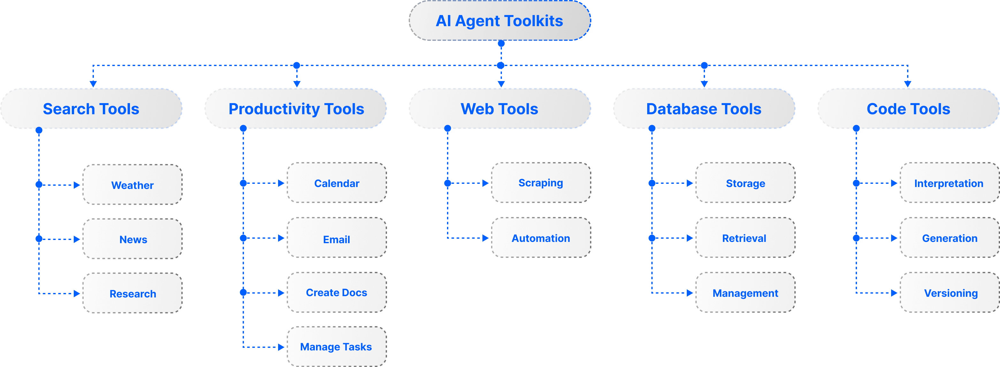

# ⚒️ The AI Agent Tools Catalog 🛠️

## Discover a repository of tools to plug and play with your AI agents easily. 

| Tool/Toolkit | Description | Pricing |
|-------------|-------------|----------|
| [Arxiv](https://arxiv.org/) | Tools to read arXiv papers | Free |
| [BaiduSearch](https://www.baidu.com/) | Chinese search engine | Free |
| [Bing Search](https://www.bing.com/) | Bing Search is an Azure service and enables safe, ad-free, location-aware web search | Paid |
| [Brave Search](https://search.brave.com/) | Web search tool using Brave's search engine | Free |
| [Code Docs Search](https://github.com/crewAIInc/crewAI-tools) | Tool for searching code documentation | Free |
| [CSV Search](https://github.com/crewAIInc/crewAI-tools) | Tool for searching CSV files | Free |
| [Directory Search](https://github.com/crewAIInc/crewAI-tools) | Tool for searching directories | Free |
| [DOCX Search](https://github.com/crewAIInc/crewAI-tools) | Tool for searching Word documents | Free |
| [DuckDuckGo Search](https://duckduckgo.com/) | Privacy-focused web search engine | Free |
| [Exa Search](https://exa.ai/) | Search engine fully designed for use by LLMs | 1000 free searches/month |
| [Google Images Search API (FlashData)](https://flashdata.dev/docs/sources/google_images) | Search image URLs, thumbnails and source pages; does not download or license images. | Paid Credits; API key |
| [Google News Search API (FlashData)](https://flashdata.dev/docs/sources/google_news) | Search Google News headlines, publication details and links; not full articles. | Paid Credits; API key |
| [Google Places Search API (FlashData)](https://flashdata.dev/docs/sources/google_places) | Search local businesses and places with available addresses, ratings and contact fields. | Paid Credits; API key |
| [Google Search](https://www.google.com/) | Traditional Google web search capabilities | Paid |
| [Google Search Results API (FlashData)](https://flashdata.dev/docs/sources/google_search) | Retrieve structured Google web results, links and snippets; not full-page extraction. | Paid Credits; API key |
| [Google Serper](https://serper.dev/) | Google search API alternative | Free |
| [Google Shopping Search API (FlashData)](https://flashdata.dev/docs/sources/google_shopping) | Retrieve Google Shopping product links, merchants and displayed prices; no stock guarantee. | Paid Credits; API key |
| [Google Video Search API (FlashData)](https://flashdata.dev/docs/sources/google_videos) | Find video results across websites through Google Videos search. | Paid Credits; API key |
| [HackerNews](https://news.ycombinator.com/) | Tools to read Hacker News articles | Free |
| [Jina Search](https://jina.ai/) | Neural search engine | 1M Response Tokens Free |
| [JSON Search](https://github.com/crewAIInc/crewAI-tools) | Tool for searching JSON files | Free |
| [MDX Search](https://github.com/crewAIInc/crewAI-tools) | Tool for searching MDX files | Free |
| [Mojeek Search](https://www.mojeek.com/) | Independent search engine | Paid |
| [PDF Search](https://github.com/crewAIInc/crewAI-tools) | Tool for searching PDF files | Free |
| [PubMed](https://pubmed.ncbi.nlm.nih.gov/) | Tools to search PubMed medical database | Free |
| [SearchApi](https://www.searchapi.io/) | Web search API | 100 Free Searches on Sign Up |
| [SearxNG Search](https://searx.space/) | Self-hosted metasearch engine | Free |
| [SerpAPI](https://serpapi.com/) | Real-time search engine results API | 100 Free Searches/Month |
| [Tavily Search](https://tavily.com/) | Search engine built specifically for AI agents | 1000 free searches/month |
| [TXT Search](https://github.com/crewAIInc/crewAI-tools) | Tool for searching text files | Free |
| [Website Search](https://github.com/crewAIInc/crewAI-tools) | Tool for searching websites | Free |
| [Wikipedia](https://www.wikipedia.org/) | Tools to search Wikipedia | Free |
| [XML Search](https://github.com/crewAIInc/crewAI-tools) | Tool for searching XML files | Free |
| [You.com Search](https://you.com/) | AI-first search engine | Free for 60 days |
| [YouTube Autocomplete API (FlashData)](https://flashdata.dev/docs/sources/youtube_suggestions) | Retrieve YouTube autocomplete phrases from a prefix; not search-volume measurements. | Paid Credits; API key |
| [YouTube Channel Data API (FlashData)](https://flashdata.dev/docs/sources/youtube_channel) | Retrieve a channel profile and recent videos by handle; not a complete historical archive. | Paid Credits; API key |
| [YouTube Channel Search](https://github.com/crewAIInc/crewAI-tools) | Tool for searching YouTube channels | Free |
| [YouTube Download to Cloud Storage API (FlashData)](https://flashdata.dev/docs/sources/youtube_download) | Submit asynchronous video or audio downloads to customer cloud storage; paid delivery. | Paid Credits; API key |
| [YouTube Extended Search API (FlashData)](https://flashdata.dev/docs/sources/youtube_search_extended) | Search YouTube with a requested limit up to 700; separate rate, results may be fewer. | Paid Credits; API key |
| [YouTube License Metadata API (FlashData)](https://flashdata.dev/docs/sources/youtube_trainability) | Read video license metadata for a Creative Commons label; does not grant training rights. | Paid Credits; API key |
| [YouTube Transcript API (FlashData)](https://flashdata.dev/docs/sources/youtube_transcript) | Read existing YouTube transcript segments and text, defaulting to automatic captions; no ASR. | Paid Credits; API key |
| [YouTube Uploader Captions API (FlashData)](https://flashdata.dev/docs/sources/youtube_captions) | Read existing uploader-caption segments and text; no generation, translation or automatic fallback. | Paid Credits; API key |
| [YouTube Video Metadata API (FlashData)](https://flashdata.dev/docs/sources/youtube_metadata) | Retrieve video metadata, available format information and chapters by video ID. | Paid Credits; API key |
| [YouTube Video Search](https://github.com/crewAIInc/crewAI-tools) | Tool for searching YouTube videos | Free |
| [YouTube Video Search API (FlashData)](https://flashdata.dev/docs/sources/youtube_search) | Search YouTube videos by keyword with a requested result limit of 1 to 20. | Paid Credits; API key |

## Code Interpreter

| Tool/Toolkit | Description | Pricing |
|-------------|-------------|----------|
| [AI Mind](https://github.com/crewAIInc/crewAI-tools) | Tool for AI-powered code analysis | Free |
| [Azure Container Apps dynamic sessions](https://azure.microsoft.com/products/container-apps/) | Secure and scalable sandbox environments for code execution | Azure pricing |
| [Bearly Code Interpreter](https://bearly.ai/) | Remote code execution service | Contact for pricing |
| [DALL-E Tool](https://github.com/crewAIInc/crewAI-tools) | Tool for image generation using DALL-E | Paid |
| [E2B Data Analysis](https://e2b.dev/) | Cloud environments for LLM code execution | Contact for pricing |
| [Python REPL](https://python.langchain.com/) | Local Python code execution environment | Free |
| [Python Tools](https://python.org/) | Tools to write and run Python code | Free |
| [Riza Code Interpreter](https://riza.io/) | WASM-based isolated environment for code execution | Contact for pricing |
| [Shell Tools](https://www.gnu.org/software/bash/) | Tools to run shell commands | Free |
| [Vision Tool](https://github.com/crewAIInc/crewAI-tools) | Tool for computer vision tasks | Free |

## Productivity

| Tool/Toolkit | Description | Pricing |
|-------------|-------------|----------|
| [Cal.com](https://cal.com/) | Tools to interact with Cal.com API | Free/Paid |
| [Email Tools](https://resend.com/) | Tools to send emails | Free/Paid |
| [Github Toolkit](https://github.com/) | Tools for interacting with GitHub repositories | Free |
| [Gitlab Toolkit](https://gitlab.com/) | Tools for interacting with GitLab repositories | Free for personal projects |
| [Gmail Toolkit](https://gmail.com/) | Email automation and management tools | Free with quota limits |
| [Google Calendar](https://calendar.google.com/) | Calendar management tools | Free with quota limits |
| [Jira Toolkit](https://www.atlassian.com/software/jira) | Project management and issue tracking tools | Free with rate limits |
| [Linear](https://linear.app/) | Project management tools | Free/Paid |
| [Office365 Toolkit](https://www.office.com/) | Microsoft Office integration tools | Free with Office365 subscription |
| [Resend](https://resend.com/) | Email sending service | Free/Paid |
| [Slack Toolkit](https://slack.com/) | Slack workspace interaction tools | Free |
| [Twilio](https://www.twilio.com/) | Communication API tools | Free trial, then pay-as-you-go |
| [Zendesk](https://www.zendesk.com/) | Customer service tools | Paid |
| [Zoom](https://zoom.us/) | Video conferencing tools | Free/Paid |

## Web Browsing

| Tool/Toolkit | Description | Pricing |
|-------------|-------------|----------|
| [Browserbase Load](https://github.com/crewAIInc/crewAI-tools) | Tool for loading web browsers | Free |
| [Crawl4AI](https://crawl4ai.com/) | Tools to crawl web data | Contact for pricing |
| [Firecrawl](https://firecrawl.co/) | Tools to crawl the web | Contact for pricing |
| [Hyperbrowser Load](https://github.com/crewAIInc/crewAI-tools) | Advanced browser automation tool | Free |
| [MultiOn Toolkit](https://multion.ai/) | AI agent for web browser automation | 40 free requests/day |
| [Newspaper](https://newspaper.readthedocs.io/) | Tools to read news articles | Free |
| [Newspaper4k](https://newspaper.readthedocs.io/) | Tools to read articles | Free |
| [PlayWright Browser Toolkit](https://playwright.dev/) | Browser automation and testing framework | Free |
| [Requests Toolkit](https://requests.readthedocs.io/) | HTTP library for making web requests | Free |
| [Scrape Element From Website](https://github.com/crewAIInc/crewAI-tools) | Tool for scraping specific elements | Free |
| [Scrapegraph](https://github.com/crewAIInc/crewAI-tools) | Graph-based web scraping tool | Free |
| [Scrapfly](https://github.com/crewAIInc/crewAI-tools) | Web scraping automation tool | Free |
| [Selenium Scraping](https://github.com/crewAIInc/crewAI-tools) | Selenium-based web scraping tool | Free |
| [Spider](https://scrapy.org/) | Tools to crawl websites | Free |
| [Website Tools](https://beautiful-soup-4.readthedocs.io/) | Tools to scrape websites | Free |

## Database

| Tool/Toolkit | Description | Pricing |
|-------------|-------------|----------|
| [Cassandra Database Toolkit](https://cassandra.apache.org/) | Tools for Apache Cassandra database operations | Free |
| [DuckDb](https://duckdb.org/) | Tools to run SQL using DuckDb | Free |
| [MySQL Search](https://github.com/crewAIInc/crewAI-tools) | Tool for searching MySQL databases | Free |
| [OpenBB](https://openbb.co/) | Tools to search for stock data | Free |
| [Pandas](https://pandas.pydata.org/) | Tools to manipulate data using Pandas | Free |
| [PostgreSQL Search](https://github.com/crewAIInc/crewAI-tools) | Tool for searching PostgreSQL databases | Free |
| [Snowflake Search](https://github.com/crewAIInc/crewAI-tools) | Tool for searching Snowflake databases | Free |
| [Spark SQL Toolkit](https://spark.apache.org/) | Tools for Apache Spark SQL operations | Free |
| [SQLDatabase Toolkit](https://python.langchain.com/) | Tools for SQL database operations | Free |
| [Weaviate](https://github.com/crewAIInc/crewAI-tools) | Vector database search tool | Free |
| [YFinance](https://pypi.org/project/yfinance/) | Tools to search Yahoo Finance | Free |

## File Operations

| Tool/Toolkit | Description | Pricing |
|-------------|-------------|----------|
| [Directory Read](https://github.com/crewAIInc/crewAI-tools) | Tool for reading directory contents | Free |
| [File Read](https://github.com/crewAIInc/crewAI-tools) | Tool for reading file contents | Free |
| [File Writer](https://github.com/crewAIInc/crewAI-tools) | Tool for writing to files | Free |
| [PDF Text Writing](https://github.com/crewAIInc/crewAI-tools) | Tool for writing text to PDFs | Free |
